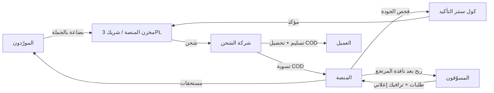

# 01 — المنتج والتميّز

## 1. ما الذي نبنيه

سوق ذو ثلاثة أطراف يعمل بالدفع عند الاستلام:

## 2. الشرائح

| الشريحة | حاجتها الأساسية | ما نقدمه |
|---|---|---|
| **مسوّق مبتدئ** (ميزانية إعلان صغيرة) | لا يخسر فلوسه في تجربة، يفهم الربح الحقيقي | حاسبة ربح تشمل الشحن ونسبة المرتجع، منتجات مصنّفة بنسبة نجاح |
| **مسوّق محترف** (يصرف آلاف يوميًا) | مخزون موثوق، دفع منتظم، تتبع إعلاني | حجز مخزون، Pixel/CAPI، تحليلات لكل إعلان، حدود دفع أعلى |
| **مورّد** | بيع كميات كبيرة وتسوية واضحة | بوابة مورّد، تقارير مبيعات ومخزون، تسوية دورية |
| **فريق التشغيل** | طابور مرتب وسياسة اتصال واضحة | CRM للكول سنتر، سكربتات، مراجعة جودة |

## 3. نقاط التميّز (مقابل ما نفترضه من ضعف المنافسين)

كل نقطة مرتبطة بفرضية في [06](06-risks-and-validation.md) يجب التحقق منها بمقابلات قبل الالتزام.

| # | التميّز | كيف يتحقق تقنيًا |
|---|---|---|
| D1 | **أسباب إلغاء ومرتجع شفافة** | Reason codes إلزامية في كل انتقال حالة + سجل `order_events` غير قابل للتعديل + عرضه للمسوّق |
| D2 | **ضمان زمن الدفع** | نافذة مرتجع ثابتة ثم دفعة تلقائية مجدولة؛ مؤشر "زمن الدفع الفعلي" علني |
| D3 | **صدق المخزون** | حجز مخزون عند التأكيد، عدّ دوري، إيقاف تلقائي للروابط عند النفاد، تنبيه مبكر |
| D4 | **حاسبة الربح الصادقة** | عرض الصافي لو سُلّم، والخسارة لو رُفض، قبل إرسال الطلب |
| D5 | **فلترة الطلبات الوهمية مبكرًا** | تطبيع الأرقام، كشف التكرار، سجل رفض العميل (مجزّأ بـ hash)، تقييم عنوان |
| D6 | **درجة جودة المسوّق** | نسبة التسليم تحدد الحد اليومي والمستوى والمكافأة، شفافة للمسوّق |
| D7 | **تتبع إعلاني حقيقي** | UTM + Pixel + Conversions API (Meta، TikTok) مع إرسال حدث "تم التسليم" |
| D8 | **دعم بتذاكر وSLA** | تذكرة مربوطة بالطلب، وقت رد مقيس، قنوات واتساب |
| D9 | **أدوات AI بالعامية المصرية** | وصف المنتج، نصوص إعلان، فحص الإعلان (عبر وحدة AI موجودة في aiSSS كمرجع) |

## 4. الـ Wedge (كيف ندخل سوقًا فيه لاعب ممول)

تاجر ممولة (جولة seed بـ 6.4 مليون دولار حسب تقارير صحفية) وفتحت مكتب توريد في الصين، أي أنها تتحول إلى سلسلة إمداد متكاملة. **لن ننافسها في الكتالوج الواسع.** المقترح:

1. **نبدأ بـ 1-2 فئة منتجات** (مثلًا العناية المنزلية أو الإكسسوارات) بمورّدين شركاء، 50-100 SKU فقط، مخزون نتحقق منه فعليًا.
2. **نتعاقد مع شريك 3PL وشركة شحن وكول سنتر** بدل البناء الداخلي في البداية (رأس مال أقل، مرونة أعلى).
3. **نعلن مؤشرات الأداء الحقيقية** (زمن الدفع، نسبة التسليم، نسبة نفاد المخزون) كأداة تسويق.
4. **نجذب 30-50 مسوّقًا محترفًا غاضبًا** من المنصات الحالية ونبني معهم، لا مئات المبتدئين.

## 5. خارج النطاق (في MVP)

تطبيق جوال أصلي، دول متعددة، متجر مستهلك مباشر، مستودعات مملوكة، استيراد من الصين.

## 6. نموذج الإيراد

- **هامش جملة**: المنصة تبيع للمسوّق بسعر جملة أعلى من تكلفة المورّد (أو عمولة ثابتة من المورّد).
- **رسم تشغيل لكل طلب مسلَّم** (شحن + COD + تأكيد) بحسب الشرائح.
- **لا نقتطع نسبة خفية من ربح المسوّق.** المسوّق يرى معادلة الربح كاملة قبل الإرسال.
- لاحقًا: اشتراك Pro (حدود أعلى، تحليلات)، وإعلانات منتجات من المورّدين.

> الأرقام النهائية للهوامش تحتاج دراسة جدوى مع بيانات شحن وكول سنتر حقيقية. لا نثبت أي رقم قبل الـ pilot.
