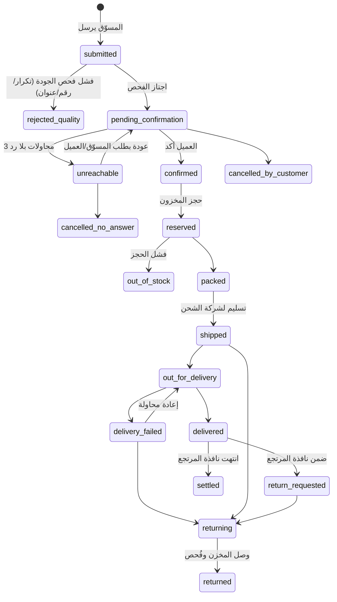

# 02 — الهندسة المعمارية

## 1. التقنيات (مقترح، قابل للتعديل قبل بدء الكود)

| الطبقة | الاختيار | السبب |
|---|---|---|
| Backend | **Laravel 12 / PHP 8.3** | نفس خبرة الفريق في aiSSS، نظام queues وevents ناضج |
| DB | **MySQL 8** (InnoDB) | transactions + `SELECT … FOR UPDATE` للدفتر المالي |
| Cache/Queue | **Redis** + Laravel Horizon | طوابير الإشعارات والتسوية والـ webhooks. بديل مؤقت: `database` queue |
| لوحة الإدارة/الكول سنتر | **Filament** | يوفر أسابيع من CRUD والجداول والفلاتر، يدعم RTL والصلاحيات |
| تطبيق المسوّق | **Inertia + React + Tailwind (RTL) كـ PWA** | الأغلب موبايل، قابل للتثبيت، بلا متجر تطبيقات في البداية |
| API | REST v1 موثّق (OpenAPI) | للتكاملات (Shopify/Woo/صفحات هبوط) |
| الملفات | S3-compatible (مستندات KYC مشفّرة) | |
| المراقبة | Sentry + Laravel Telescope (dev) + سجل تدقيق | |
| CI | GitHub Actions: Pint، PHPStan (level 8)، Pest | |
| النشر | VPS (Hostinger VPS أو مكافئ) + Docker Compose | shared hosting لا يصلح لطوابير ومهام مجدولة موثوقة |

> قبل التثبيت: تحقق من أحدث إصدارات Laravel وFilament المتوافقة مع PHP 8.3.

## 2. الأسلوب: Modular Monolith

تطبيق واحد، وحدات منفصلة بحدود واضحة (مجلد لكل وحدة، تواصل عبر Events وواجهات Service فقط، لا وصول مباشر لجداول وحدة أخرى).

```
app/Domain/
  Identity/      مسوّقون، مورّدون، موظفون، KYC، صلاحيات
  Catalog/       منتجات، متغيّرات، تسعير، مواد تسويقية
  Inventory/     مخازن، أرصدة، حجوزات، حركات
  Orders/        الطلب، آلة الحالات، فحص الجودة
  CallCenter/    طوابير، محاولات اتصال، سكربتات، QA
  Fulfillment/   تجهيز، تكامل شركات الشحن، تتبع
  Finance/       الدفتر المزدوج، المحافظ، التسوية، السحب
  Growth/        روابط، تتبع إعلاني، Pixel/CAPI، مستويات
  Support/       تذاكر، SLA
  Notifications/ SMS، واتساب، بريد، إشعارات داخل التطبيق
```

## 3. آلة حالات الطلب (Order State Machine)

**قاعدة ذهبية:** لا يغيّر أي كود `orders.status` مباشرة. كل انتقال يمر عبر `OrderTransitionService::transition($order, $to, $reasonCode, $actor)` الذي يتحقق من الانتقال المسموح، يكتب `order_events`، ويطلق Event تتفاعل معه الوحدات الأخرى (المخزون، المالية، الإشعارات). هذا يعالج تناثر تغييرات الحالة بين الـ Controllers وObserver في aiSSS.



كل انتقال إلى حالة نهائية سلبية يتطلب `reason_code` من قائمة محددة (مثل: `CUSTOMER_REFUSED_PRICE`، `CUSTOMER_NOT_ORDERED`، `ADDRESS_INVALID`، `COURIER_NO_ATTEMPT`، `PRODUCT_DAMAGED`) ويظهر للمسوّق.

## 4. الدفتر المالي (Finance Ledger)

### المبادئ
- **المبالغ أعداد صحيحة بالقروش** (`BIGINT`)، لا `float` ولا `DECIMAL` في الحساب. (aiSSS يستخدم `float` في الخدمات.)
- **قيد مزدوج:** كل `journal_entry` له سطور `ledger_lines` مجموعها صفر.
- **غير قابل للتعديل:** لا UPDATE ولا DELETE على القيود. التصحيح بقيد عكسي.
- **Idempotency:** لكل قيد `idempotency_key` فريد (مثل `order:123:settle`)، فتكرار الحدث لا يضاعف الرصيد.
- **الأرصدة المخزنة** (`accounts.balance`) تُحدَّث في نفس المعاملة مع `lockForUpdate()`، وتُراجَع ليليًا مقابل مجموع السطور.

### الحسابات
| الحساب | الغرض |
|---|---|
| `aff:{id}:pending` | ربح طلبات مؤكدة/مشحونة لم تُسلَّم أو داخل نافذة المرتجع |
| `aff:{id}:available` | قابل للسحب |
| `aff:{id}:locked` | محجوز لطلب سحب قيد المراجعة |
| `platform:cod_receivable` | مبالغ COD لدى شركات الشحن لم تُسوَّ |
| `platform:revenue` | هامش المنصة |
| `supplier:{id}:payable` | مستحقات المورّد |
| `courier:{id}:clearing` | حساب وسيط لتسوية كشف شركة الشحن |

### أمثلة قيود
| الحدث | المدين | الدائن |
|---|---|---|
| تسليم الطلب | `cod_receivable` | `aff:pending` + `supplier:payable` + `platform:revenue` |
| انتهاء نافذة المرتجع | `aff:pending` | `aff:available` |
| طلب سحب | `aff:available` | `aff:locked` |
| دفع السحب | `aff:locked` | `external:payout_clearing` |
| مرتجع بعد التسوية | `aff:available` (قد يصير سالبًا = دين) | `aff:pending` عكسي / `cod_receivable` |

**الدين:** لو رصيد المسوّق صار سالبًا بسبب مرتجع متأخر، يُمنع السحب حتى يُسدَّد من أرباح قادمة.

### قواعد السحب
- حد أدنى معلن، دفعات مجدولة (مثلًا مرتان أسبوعيًا) + سحب فوري اختياري برسم.
- كل طلب سحب: `status` (requested → approved → paid | rejected) + مرجع تحويل + إيصال.
- أي سحب فوق حد معين يتطلب 2FA وموافقة ثانية (maker-checker).

## 5. التسعير

كل طلب يحفظ **لقطة تسعير** (`price_snapshot`) لحظة الإرسال: سعر الجملة، سعر البيع، الشحن، رسم COD، ربح المسوّق، هامش المنصة. **كل الحساب على السيرفر.** القيم التي يرسلها المتصفح (مثل الشحن) لا يُوثَق بها (في aiSSS: `shipping_cost` يُقرأ من مدخلات المستخدم).

```
ربح المسوّق (للوحدة) = سعر_البيع − سعر_الجملة            (تخصم المنصة من سعر الجملة لا من الربح)
المحصَّل من العميل    = سعر_البيع × الكمية + الشحن(حسب المحافظة)
قيود: سعر_الجملة ≤ سعر_البيع ≤ سقف_السعر_للمنتج
```

## 6. فحص جودة الطلب (Order Quality Gate)

يعمل بشكل متزامن خفيف عند الإرسال ثم Job أعمق:
1. تطبيع الهاتف المصري (`01[0125]xxxxxxxx`) إلى E.164.
2. تكرار: نفس الهاتف + نفس المنتج خلال N أيام ⇒ إنذار/دمج.
3. سجل الرفض: `customer_reputation` مجزّأ بـ hash للهاتف (عدد الطلبات المرفوضة والمُسلَّمة).
4. اكتمال العنوان: محافظة/مدينة من قاموس + حد أدنى لطول العنوان + تحذير من النصوص العشوائية.
5. حد أقصى للطلبات الجديدة يوميًا لكل مسوّق بحسب درجته.
6. نتيجة: `pass` / `review` (تذهب لمراجعة بشرية) / `reject` مع reason_code.

## 7. التكاملات

| التكامل | الغرض | ملاحظة |
|---|---|---|
| شركات الشحن | إنشاء بوليصة، تتبع، كشف COD | كل شركة خلف `CourierGateway` interface. **تحقق من توفر API وشروطه لكل شركة قبل الالتزام.** |
| SMS / WhatsApp Business API | إشعارات وتأكيد | تكلفة وقوالب معتمدة؛ تحقق من المزوّد |
| Meta CAPI / TikTok Events API | إرسال حدث "تم التسليم" | يحسن تحسين الحملات |
| بوابات الدفع/التحويل | دفع المسوّقين (Instapay، محافظ، بنك) | البداية يدوية مع إيصال، ثم أتمتة بعد التحقق من خيارات الدفع الجماعي |
| Shopify/WooCommerce | ربط متجر المسوّق | Webhook يحوّل طلب المتجر إلى طلب في المنصة |
| LLM (Claude API) | أدوات المحتوى | عبر مزوّد قابل للتبديل |

## 8. الأمان والخصوصية

- Authentication منفصل لكل حارس (marketer/staff/supplier)، 2FA إلزامي للموظفين وللسحب.
- RBAC بدرجة دقيقة (Spatie Permission أو Filament Shield): لا يرى موظف الكول سنتر البيانات المالية.
- **عزل بيانات العميل:** المسوّق يرى اسم العميل والمحافظة وحالة الطلب، لا رقم هاتفه بعد التأكيد، لمنع سرقة العملاء. (قرار منتج يحتاج اختبارًا مع المسوّقين.)
- تشفير مستندات KYC وحقول الحسابات البنكية at-rest.
- سجل تدقيق (Audit Log) لكل عملية مالية وإدارية.
- Rate limiting وحماية من القوة الغاشمة، وفحص رفع الملفات.
- الامتثال: قانون حماية البيانات الشخصية المصري رقم 151 لسنة 2020. **يلزم مراجعة محامٍ** قبل الإطلاق.

## 9. الاختبار

| النوع | المحتوى |
|---|---|
| Property tests | مجموع كل قيد = صفر؛ إعادة تشغيل نفس الحدث لا تغيّر الأرصدة |
| Concurrency tests | طلبا سحب متزامنان لا يتجاوزان الرصيد؛ حجزان متزامنان لا يتجاوزان المخزون |
| State machine tests | كل انتقال مسموح يعمل، وكل انتقال غير مسموح يرفض |
| Feature tests | رحلة المسوّق من التسجيل حتى السحب |
| Reconciliation test | رصيد الحساب المخزن = مجموع سطور الدفتر |

## 10. قرارات معمارية (ADR مختصرة)

| القرار | البديل المرفوض | السبب |
|---|---|---|
| مشروع Laravel جديد نظيف | البناء فوق 6Valley | حجم، ترخيص، تعقيد غير مرتبط، تعارض نماذج Order/Product |
| Modular monolith | Microservices | فريق صغير، لا حاجة لتعقيد النشر |
| أعداد صحيحة بالقروش | DECIMAL/float | لا أخطاء تقريب |
| Filament للإدارة | بناء Blade يدوي | وقت التطوير |
| 3PL وكول سنتر خارجي في البداية | مستودع وكول سنتر داخلي | رأس مال، سرعة الاختبار |
