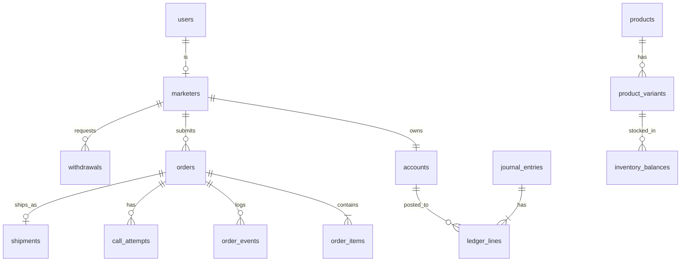

# 03 — مخطط قاعدة البيانات (الأساسي)

اصطلاحات: `BIGINT UNSIGNED` للمفاتيح، المبالغ `BIGINT` بالقروش (اسم العمود ينتهي بـ `_minor`)، الأوقات `TIMESTAMP`، التسميات الإنجليزية، `utf8mb4_unicode_ci`.



## الهوية

```sql
marketers (
  id, user_id UNIQUE, status ENUM('pending','active','suspended','rejected'),
  level_id, quality_score SMALLINT, daily_order_cap INT,
  kyc_status ENUM('none','submitted','verified','rejected'),
  kyc_docs_encrypted JSON NULL,
  payout_method ENUM('wallet','instapay','bank'), payout_details_encrypted TEXT,
  referral_code UNIQUE, referred_by NULL, created_at, updated_at
)
staff (id, user_id UNIQUE, team ENUM('call_center','ops','finance','support','admin'), ...)
suppliers (id, name, contact JSON, settlement_terms JSON, status, ...)
```

## الكتالوج والمخزون

```sql
products (id, supplier_id, name, slug UNIQUE, category_id, status,
          wholesale_minor BIGINT, min_price_minor BIGINT, max_price_minor BIGINT,
          success_rate DECIMAL(5,2) NULL /* محسوبة من الطلبات */, ...)
product_variants (id, product_id, sku UNIQUE, attributes JSON, wholesale_minor NULL)
warehouses (id, name, type ENUM('own','3pl','supplier'), ...)
inventory_balances (variant_id, warehouse_id, on_hand INT, reserved INT,
                    PRIMARY KEY (variant_id, warehouse_id),
                    CHECK (reserved >= 0 AND reserved <= on_hand))
inventory_movements (id, variant_id, warehouse_id, delta INT,
                     reason ENUM('inbound','reserve','release','ship','return','adjust','count'),
                     ref_type, ref_id, created_at)   -- append-only
marketing_assets (id, product_id, type ENUM('image','video','copy','zip'), path/url, copy_text, ...)
```

## الطلبات

```sql
orders (
  id, public_ref UNIQUE, marketer_id, status VARCHAR(40), 
  customer_name, customer_phone_e164, customer_phone_hash CHAR(64) INDEX,
  governorate_id, city, address, notes,
  price_snapshot JSON,                    -- لقطة التسعير (الشحن، الجملة، الربح…)
  subtotal_minor, shipping_minor, cod_total_minor, marketer_profit_minor,
  quality_result ENUM('pass','review','reject'), quality_flags JSON,
  source ENUM('app','api','shopify','woo','import'), utm JSON NULL,
  idempotency_key UNIQUE NULL,            -- لمنع تكرار الإرسال من API
  submitted_at, confirmed_at, delivered_at, settled_at, ...
  INDEX (marketer_id, status), INDEX (customer_phone_hash, created_at)
)
order_items (id, order_id, variant_id, qty, unit_price_minor, unit_wholesale_minor)
order_events (id, order_id, from_status, to_status, reason_code, actor_type, actor_id, meta JSON, created_at)  -- append-only
call_attempts (id, order_id, staff_id, outcome ENUM('answered','no_answer','busy','wrong_number','refused'),
               recording_url NULL, note, created_at)
customer_reputation (phone_hash PK, delivered INT, refused INT, last_seen_at)
```

## الشحن

```sql
couriers (id, code, name, config_encrypted JSON, active)
shipments (id, order_id UNIQUE, courier_id, awb UNIQUE, status, cod_expected_minor,
           cod_collected_minor NULL, delivered_at NULL, returned_at NULL, last_event_at)
courier_statements (id, courier_id, period_start, period_end, total_cod_minor, file_path, imported_at, matched_at NULL)
courier_statement_lines (id, statement_id, awb, cod_minor, matched_shipment_id NULL, diff_minor)
```

## المالية

```sql
accounts (id, owner_type, owner_id, kind VARCHAR(40), currency CHAR(3) DEFAULT 'EGP',
          balance_minor BIGINT DEFAULT 0, UNIQUE (owner_type, owner_id, kind))
journal_entries (id, type VARCHAR(40), idempotency_key VARCHAR(120) UNIQUE,
                 ref_type, ref_id, description, created_by NULL, created_at)    -- append-only
ledger_lines (id, entry_id, account_id, amount_minor BIGINT /* signed */, created_at,
              INDEX (account_id, id))
-- invariant (enforced in service + test + nightly check): SUM(amount_minor) per entry_id = 0

withdrawals (id, marketer_id, amount_minor, fee_minor, method, details_encrypted,
             status ENUM('requested','approved','paid','rejected'),
             rejection_reason NULL, receipt_path NULL, transfer_ref NULL,
             requested_by_ip, approved_by NULL, paid_by NULL, paid_at NULL, created_at)
```

## النمو والدعم

```sql
levels (id, name, min_delivered, min_delivery_rate DECIMAL(5,2), perks JSON)
tracking_links (id, marketer_id, product_id, slug UNIQUE, custom_price_minor NULL, is_active)
link_clicks (id, link_id, ip_hash, ua_hash, utm JSON, created_at)    -- مع سياسة حذف دورية
pixel_configs (marketer_id, provider ENUM('meta','tiktok'), pixel_id, token_encrypted)
tickets (id, marketer_id, order_id NULL, subject, status, priority, sla_due_at, ...)
ticket_messages (id, ticket_id, author_type, author_id, body, attachments JSON, created_at)
audit_logs (id, actor_type, actor_id, action, subject_type, subject_id, before JSON, after JSON, ip, created_at)
```

## قيود وفهارس حرجة

| القيد | الغرض |
|---|---|
| `journal_entries.idempotency_key UNIQUE` | منع القيد المزدوج عند تكرار الحدث |
| `inventory_balances` CHECK على reserved/on_hand | منع الحجز الزائد على مستوى القاعدة |
| `orders.idempotency_key UNIQUE` | منع تكرار الطلب من API |
| `shipments.awb UNIQUE`، `order_id UNIQUE` | بوليصة واحدة لكل طلب |
| `order_events` و`ledger_lines` و`inventory_movements` بلا UPDATE/DELETE (صلاحية DB أو trigger) | سجل غير قابل للتعديل |
