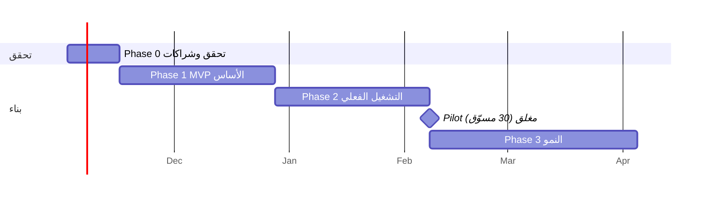

# 04 — خارطة الطريق

افتراض التقدير: مطوّر رئيسي واحد بمساعدة Claude Code، وتفرغ تشغيلي لشخص واحد على الأقل للشراكات. الأرقام تقديرات أولية تُراجع بعد Phase 0.

> التواريخ للإيضاح فقط وتبدأ بعد قرار البدء.

---

## Phase 0 — التحقق والشراكات (أسبوعان)

**لا كود تطبيق قبل إنهائها.**

- [ ] 20 مقابلة مع مسوّقين نشطين على المنصات الأربع (دليل الأسئلة في [06](06-risks-and-validation.md)).
- [ ] توثيق نقاط الألم الحقيقية مرتبة بالتكرار والأثر المالي.
- [ ] الاتفاق مبدئيًا مع: مورّد أو اثنين، شركة شحن، كول سنتر/3PL.
- [ ] نموذج وحدة اقتصادية (Unit Economics) على 3 منتجات حقيقية: تكلفة، شحن، نسبة تأكيد وتسليم، رسوم COD.
- [ ] استشارة قانونية: كيان الشركة، ضريبة، حماية بيانات، شروط الاستخدام.
- [ ] قرار الاسم والنطاق.

**معيار الخروج:** 3 من 5 فرضيات تميّز مؤكدة بمقابلات، وعقد مبدئي مع شحن وتوريد، ووحدة اقتصادية موجبة.

---

## Phase 1 — MVP الأساس (6 أسابيع)

**الهدف:** مسار كامل بالحد الأدنى: تسجيل ← طلب ← تأكيد ← حالة ← ربح ← سحب (يدوي التنفيذ).

| الأسبوع | المخرجات |
|---|---|
| 1 | هيكل Laravel، CI، Docker، Auth لثلاثة حراس، RBAC، Audit log |
| 2 | الكتالوج والمتغيرات والتسعير، لوحة Filament للمنتجات، المواد التسويقية |
| 3 | إدخال الطلب (واجهة المسوّق)، لقطة التسعير، حاسبة الربح، فحص الجودة v1 |
| 4 | `OrderTransitionService` + order_events + طابور الكول سنتر + محاولات الاتصال |
| 5 | الدفتر المالي: accounts/journal/ledger، قيود التسليم والنافذة، المحفظة، اختبارات الدفتر |
| 6 | السحب (maker-checker)، لوحة المالية، إشعارات SMS أساسية، تقارير المسوّق v1 |

**معايير الخروج:**
- [ ] جميع اختبارات الدفتر (مجموع صفر، idempotency، تزامن) تنجح.
- [ ] لا مسار كود يغيّر `orders.status` خارج الخدمة (فحص PHPStan/Arch test).
- [ ] طلب يمر كاملًا في بيئة staging، ويظهر ربحه في المحفظة ويُسحب.

---

## Phase 2 — التشغيل الفعلي (6 أسابيع)

| الأسبوع | المخرجات |
|---|---|
| 7-8 | المخزون: أرصدة، حجز، حركات، عدّ دوري، إيقاف الروابط عند النفاد |
| 9-10 | تكامل شركة الشحن الأولى (بوليصة، تتبع Webhook/Polling)، كشف COD والتسوية |
| 11 | قاموس المحافظات والمدن وتسعير الشحن، سجل سمعة العميل |
| 12 | بوابة المورّد (مخزون/مبيعات)، تسوية الموردين، لوحة KPI التشغيلية |

**معايير الخروج:** Pilot مغلق مع 30 مسوّقًا و2 مورّدين لمدة 4 أسابيع، وتسوية COD مع الشحن تطابق الدفتر.

---

## Phase 3 — النمو (8 أسابيع)

- Pixel + Conversions API (Meta، TikTok) وإرسال حدث "تم التسليم".
- تكامل Shopify/WooCommerce + API عام + Webhooks.
- روابط تتبع وصفحات هبوط/نموذج طلب قابل للتضمين.
- أدوات AI للمحتوى بالعامية المصرية.
- المستويات ودرجة الجودة (D6) وحدود الطلبات.
- مركز الدعم (تذاكر + SLA) وقنوات واتساب.
- دفع آلي للمسوّقين (بعد دراسة الخيارات والتراخيص).
- لوحة "المؤشرات العلنية" (زمن الدفع، نسبة التسليم).

---

## Phase 4 — التوسع (بعد إثبات الاقتصاد)

PWA ← تطبيق جوال، السعودية/الإمارات (عملة، ضريبة، شحن)، مخازن إضافية، BI، برنامج إحالة.

---

## مؤشرات النجاح (North Star + حواجز حماية)

| المؤشر | الهدف المبدئي (يُضبط بعد Phase 0) |
|---|---|
| **North Star:** عدد الطلبات المسلَّمة أسبوعيًا | يُحدد بعد البيانات |
| نسبة التأكيد | ≥ 65% من الطلبات التي تجتاز الفحص |
| نسبة التسليم من المؤكد | ≥ 80% |
| زمن الدفع (تسليم ← متاح) | ≤ نافذة المرتجع + 24 ساعة |
| نسبة نفاد المخزون بعد الطلب | ≤ 2% |
| زمن رد الدعم الأول | ≤ 2 ساعة عمل |
| فرق الدفتر عن الواقع | 0 قرش |

> الأهداف تقدير أولي مبني على معرفة عامة بالقطاع وليس على بيانات منصة بعينها. تُستبدل بأرقام الـ pilot.

## الفريق المقترح

| الدور | البداية | لاحقًا |
|---|---|---|
| مطوّر Full-stack (Laravel + React) | 1 (أنت + Claude) | 2-3 |
| مدير عمليات/شراكات | 1 (جزئي) | 1 |
| مشرف كول سنتر | عبر شريك | داخلي |
| محاسب | استشاري | 1 |
| دعم المسوّقين | 1 | 3+ |
