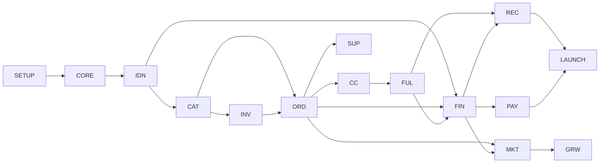

# 07 — خطة التنفيذ الكاملة

هذه الوثيقة تحوّل الوثائق 01–06 إلى مهام برمجية قابلة للتنفيذ بالترتيب. كل مهمة لها رقم ثابت (مثل `FIN-03`)، وملفات متوقعة، ومعيار قبول، واختبارات. لا تبدأ مهمة قبل إنهاء المهام التي تعتمد عليها.

> شرط البدء: بوابة G0 في [06](06-risks-and-validation.md) (المقابلات والوحدة الاقتصادية). يمكن تنفيذ `SETUP-*` بالتوازي معها لأنها لا تعتمد على قرارات المنتج.

---

## 0. قواعد العمل

### 0.1 الفروع والمراجعة
- `main` محمي: لا push مباشر، PR إلزامي، CI أخضر إلزامي.
- فرع لكل مهمة: `feat/FIN-03-ledger-posting`، `fix/ORD-07-…`.
- رسالة commit بصيغة Conventional Commits: `feat(finance): post delivery entry (FIN-03)`.
- كل PR يذكر رقم المهمة ومعيار القبول وكيف اختُبر.

### 0.2 تعريف "تم" (Definition of Done)
- [ ] الكود يمر بـ Pint وPHPStan (level 8) وESLint/TypeScript.
- [ ] اختبارات Feature/Unit للمهمة، والتغطية لا تنقص في `app/Domain/Finance` و`Orders` (هدف ≥ 90%).
- [ ] Migration قابلة للتراجع (`down`) أو موثّق أنها forward-only.
- [ ] لا مبالغ `float`، لا تغيير لحالة الطلب خارج `OrderTransitionService`، لا استعلام لجدول وحدة أخرى مباشرة (Arch tests).
- [ ] نصوص الواجهة في ملفات الترجمة (`lang/ar`, `lang/en`)، لا نصوص ثابتة.
- [ ] صلاحيات مطبقة (Policy) ومختبرة لكل endpoint جديد.
- [ ] تحديث `CHANGELOG.md` والوثائق إن تغيّر سلوك.

### 0.3 البيئات
| البيئة | الغرض | البيانات |
|---|---|---|
| `local` | تطوير (Docker Compose) | Seeders وهمية |
| `testing` | CI | قاعدة MySQL حقيقية في الـ CI (لا SQLite: نحتاج `FOR UPDATE` وCHECK) |
| `staging` | قبول ومقابلات تجريبية | نسخة مجهّلة |
| `production` | تشغيل | حقيقية، نسخ احتياطي يومي |

---

## 1. هيكل المستودع النهائي

```
affiliate-os/
├── app/
│   ├── Domain/
│   │   ├── Identity/      {Models, Actions, Policies, Events, Enums}
│   │   ├── Catalog/
│   │   ├── Inventory/
│   │   ├── Orders/        {StateMachine, Quality, Pricing, …}
│   │   ├── CallCenter/
│   │   ├── Fulfillment/   {Couriers/Contracts, Couriers/<Provider>, …}
│   │   ├── Finance/       {Ledger, Wallet, Payouts, Reconciliation}
│   │   ├── Growth/
│   │   ├── Support/
│   │   └── Notifications/
│   ├── Support/           Money, Phone, Idempotency, Audit (أدوات مشتركة)
│   ├── Http/
│   │   ├── Controllers/Marketer/   (Inertia)
│   │   ├── Controllers/Api/V1/
│   │   └── Controllers/Webhooks/
│   └── Filament/
│       ├── Admin/         (لوحة الإدارة والمالية والعمليات)
│       └── Supplier/      (بوابة المورّد)
├── resources/js/          React + TS (تطبيق المسوّق PWA)
├── database/{migrations, seeders, factories}
├── tests/{Unit, Feature, Arch, Concurrency}
├── docker/                 Dockerfiles + nginx + supervisor
├── .github/workflows/      ci.yml, deploy-staging.yml, deploy-prod.yml
└── docs/
```

**قاعدة الحدود:** وحدة تتعامل مع أخرى فقط عبر:
1. `Actions` العامة (مثل `Inventory\Actions\ReserveStock`).
2. Events (مثل `Orders\Events\OrderDelivered`).

يُفرض ذلك باختبار Pest Arch (`tests/Arch/BoundariesTest.php`).

---

## 2. خريطة الاعتماديات بين المجموعات



| الرمز | المجموعة | المرحلة |
|---|---|---|
| SETUP | تهيئة المشروع والبنية | P1 أسبوع 1 |
| CORE | أدوات مشتركة (Money, Phone, Audit, Idempotency) | P1 أسبوع 1 |
| IDN | الهوية والصلاحيات وKYC | P1 أسبوع 1-2 |
| CAT | الكتالوج والتسعير | P1 أسبوع 2 |
| ORD | الطلبات وآلة الحالات والجودة | P1 أسبوع 3-4 |
| CC | الكول سنتر | P1 أسبوع 4 |
| FIN | الدفتر المالي والمحفظة | P1 أسبوع 5 |
| PAY | السحب | P1 أسبوع 6 |
| MKT | تطبيق المسوّق (الواجهة) | P1 بالتوازي من أسبوع 2 |
| INV | المخزون | P2 أسبوع 7-8 |
| FUL | الشحن | P2 أسبوع 9-10 |
| REC | التسوية مع الشحن | P2 أسبوع 10-11 |
| SUP | بوابة المورّد | P2 أسبوع 12 |
| GRW | النمو والتكاملات | P3 |
| OPS | المراقبة والنشر والأمان | مستمر |
| LAUNCH | الإطلاق | نهاية P2 (pilot) |

> ملاحظة ترتيب: INV موضوع في P2 لكن الحجز البسيط (`INV-01..03`) مطلوب قبل `ORD-06`. ننفذ الثلاث مهام الأولى في أسبوع 3.

---

## 3. المهام التفصيلية

### SETUP — تهيئة المشروع

| ID | المهمة | المخرجات | معيار القبول |
|---|---|---|---|
| SETUP-01 | إنشاء مشروع Laravel 12 (PHP 8.3) | `composer create-project` ، `.env.example` | `php artisan test` يعمل |
| SETUP-02 | Docker Compose: app (php-fpm)، nginx، mysql:8، redis، mailpit | `docker/`, `compose.yaml` | `docker compose up` ← الصفحة تعمل على `localhost` |
| SETUP-03 | أدوات الجودة: Pint، Larastan level 8، Pest + Arch plugin، Rector (اختياري) | `pint.json`, `phpstan.neon`, `tests/Pest.php` | الأوامر تمر على المشروع الفارغ |
| SETUP-04 | CI على GitHub Actions مع خدمة MySQL 8 وRedis | `.github/workflows/ci.yml` | PR يُظهر 4 فحوص: lint, static, test, frontend |
| SETUP-05 | الواجهة: Inertia + React + TypeScript + Tailwind + RTL + i18n | `resources/js/`, `vite.config.ts` | صفحة تجريبية بالعربية RTL تُبنى في CI |
| SETUP-06 | Filament (لوحة admin) بالعربية | `app/Filament/Admin` | `/admin` يفتح بالعربية |
| SETUP-07 | Horizon + Scheduler + Supervisor config | `config/horizon.php`, `docker/supervisor` | Job تجريبي يمر عبر Redis |
| SETUP-08 | Sentry + سجلات JSON | `config/logging.php` | خطأ تجريبي يظهر في Sentry staging |
| SETUP-09 | حماية `main` وقالب PR وCODEOWNERS | `.github/` | لا يمكن الدمج بدون CI |
| SETUP-10 | ملف `CLAUDE.md` بقواعد المشروع (الحدود، المال، الحالة) | `CLAUDE.md` | موجود ومختصر |

### CORE — الأدوات المشتركة

| ID | المهمة | التفاصيل | الاختبارات |
|---|---|---|---|
| CORE-01 | `Money` Value Object | أعداد صحيحة بالقروش، عملة، جمع/طرح/ضرب بعدد صحيح، تقسيم بتوزيع الباقي (`allocate`)، تنسيق عربي. Eloquent Cast `MoneyCast` | لا يقبل float؛ `allocate(100,[1,1,1]) = [34,33,33]` |
| CORE-02 | `EgyptianPhone` | تطبيع `01x`, `+201x`, `00201x`, أرقام عربية (٠١٢…) إلى E.164، وتحقق من البادئات `010/011/012/015`، و`hash()` بـ HMAC بمفتاح سري | جدول حالات ≥ 20 مدخلًا |
| CORE-03 | Idempotency | جدول `idempotency_keys` + Middleware للـ API (`Idempotency-Key` header) + Helper للخدمات | طلبان بنفس المفتاح ⇒ نتيجة واحدة |
| CORE-04 | Audit Log | Trait `Auditable` + `AuditLogger` يسجل actor/before/after/ip | تعديل منتج يسجل سطرًا |
| CORE-05 | Enums وReason Codes مركزية | `ReasonCode` enum مع label عربي/إنجليزي ونوع (إلغاء/مرتجع/رفض جودة) | كل قيمة لها ترجمة |
| CORE-06 | إعدادات قابلة للتعديل من اللوحة | `spatie/laravel-settings` (أو جدول settings) مع Cache وقيم افتراضية مكتوبة في كلاس واحد | تغيير الإعداد ينعكس فورًا؛ لا مفاتيح نصية متفرقة (يعالج A9) |
| CORE-07 | قاموس المحافظات والمدن | Seeder للمحافظات الـ 27 ومدنها، مع أسماء عربية/إنجليزية | عدد المحافظات = 27 |

### IDN — الهوية والصلاحيات

| ID | المهمة | التفاصيل | معيار القبول |
|---|---|---|---|
| IDN-01 | `users` موحد + أنواع (marketer/staff/supplier) | Guard واحد مع `type`، أو حراس منفصلون: **قرار: حراس منفصلون بالـ session** لعزل اللوحات | مسوّق لا يدخل `/admin` |
| IDN-02 | تسجيل المسوّق | هاتف + بريد + كلمة مرور، تحقق OTP بالهاتف (Driver قابل للتبديل: log في local) | لا تفعيل بدون OTP |
| IDN-03 | حالة الحساب | `pending → active / rejected / suspended` بإجراءات Filament وسبب | المعلق لا يرسل طلبات |
| IDN-04 | KYC | رفع وجه/ظهر البطاقة، تخزين مشفر (disk خاص + `encrypted` cast للمسارات)، مراجعة من الأدمن | الملف لا يُفتح بدون صلاحية `kyc.view` |
| IDN-05 | الأدوار والصلاحيات | `spatie/laravel-permission`: `super_admin, ops_manager, call_agent, finance, support, catalog_manager` | مصفوفة صلاحيات مختبرة (Policy tests) |
| IDN-06 | 2FA للموظفين | TOTP إلزامي لـ finance/super_admin | لا وصول للمالية بدون 2FA |
| IDN-07 | بيانات الدفع للمسوّق | طريقة + تفاصيل مشفرة، تغييرها يتطلب OTP ويجمّد السحب 24 ساعة | تغيير الرقم ⇒ تجميد مسجّل |
| IDN-08 | Rate limiting وحماية الدخول | قفل بعد محاولات، Captcha بعد N | اختبار throttle |

### CAT — الكتالوج والتسعير

| ID | المهمة | التفاصيل | معيار القبول |
|---|---|---|---|
| CAT-01 | الفئات والمنتجات والمتغيرات | Filament Resources، slug، صور متعددة، SKU فريد | CRUD كامل |
| CAT-02 | التسعير | `wholesale_minor`, `min_price_minor`, `max_price_minor` لكل متغير (مع وراثة من المنتج) | `min ≥ wholesale`، `max ≥ min` (Validation + CHECK) |
| CAT-03 | جدول الشحن | سعر الشحن لكل محافظة (`shipping_rates`) + رسم COD | سعر محسوب للمحافظة |
| CAT-04 | `PriceQuote` Action | يأخذ (متغير، كمية، سعر بيع، محافظة) ⇒ يعيد لقطة: جملة، شحن، COD، ربح، إجمالي العميل، تحذيرات | الحساب على السيرفر فقط؛ اختبار جدول حالات |
| CAT-05 | المواد التسويقية | صور/فيديو/نص/ZIP لكل منتج، عداد تحميل | التحميل يعمل للمسوّق النشط فقط |
| CAT-06 | حالة المنتج | `draft/active/paused/archived` + سبب الإيقاف يظهر للمسوّق | منتج موقوف لا يقبل طلبات |
| CAT-07 | API عرض الكتالوج للمسوّق | بحث، فلترة بالفئة، ترتيب بالربح/نسبة النجاح، صفحة منتج | استعلامات بلا N+1 (اختبار عدد الاستعلامات) |

### INV — المخزون

| ID | المهمة | التفاصيل | معيار القبول |
|---|---|---|---|
| INV-01 | المخازن والأرصدة | `warehouses`, `inventory_balances (on_hand, reserved)` + CHECK | لا يمكن reserved > on_hand على مستوى DB |
| INV-02 | `ReserveStock` / `ReleaseStock` | داخل transaction مع `lockForUpdate` على صف الرصيد، يكتب `inventory_movements`، idempotent بمرجع الطلب | **اختبار تزامن**: 10 عمليات متوازية على آخر 3 قطع ⇒ 3 تنجح |
| INV-03 | `available = on_hand − reserved` في الكتالوج | يظهر للمسوّق "متاح: N" | يتحدث فورًا بعد الحجز |
| INV-04 | الوارد (Inbound) | استلام شحنة من مورّد، كميات، فحص | الرصيد يزيد بحركة `inbound` |
| INV-05 | الشحن والمرتجع | `ship` ينقص on_hand وreserved، `return` يزيد on_hand بعد الفحص (سليم/تالف) | حركات صحيحة |
| INV-06 | الجرد الدوري | جلسة جرد، فروقات، تسوية بحركة `count` بموافقة | فرق مسجل مع الموظف |
| INV-07 | تنبيهات وإيقاف تلقائي | تحت حد ⇒ تنبيه للمسوّقين الذين باعوه آخر 7 أيام؛ صفر ⇒ `paused(out_of_stock)` | Job مجدول مختبر |

### ORD — الطلبات

| ID | المهمة | التفاصيل | معيار القبول |
|---|---|---|---|
| ORD-01 | النماذج والجداول | `orders`, `order_items`, `order_events`, `customer_reputation` حسب 03 | Migrations + Factories |
| ORD-02 | `OrderStatus` enum + جدول الانتقالات | تعريف الانتقالات المسموحة والـ reason المطلوب لكل انتقال، في كلاس واحد | اختبار يولّد كل الأزواج (from,to): المسموح ينجح والباقي يرفض |
| ORD-03 | `OrderTransitionService` | `transition(Order, to, ReasonCode?, Actor, meta)`: قفل الصف، تحقق، تحديث، `order_events`، Event بعد commit (`afterCommit`) | Arch test: لا كتابة لـ `status` خارجها |
| ORD-04 | `SubmitOrder` Action | Validation بـ FormRequest (`validated()` فقط)، PriceQuote على السيرفر، idempotency، حد يومي للمسوّق | إرسال `shipping_cost` من العميل لا أثر له (يعالج A8) |
| ORD-05 | Quality Gate v1 | تطبيع الهاتف، تكرار (هاتف+منتج خلال 7 أيام)، سمعة العميل، اكتمال العنوان ⇒ `pass/review/reject` + flags | جدول حالات؛ النتيجة تظهر للمسوّق خلال ثوانٍ |
| ORD-06 | ربط الحجز | Listener على `OrderConfirmed` ⇒ `ReserveStock` ⇒ نجاح `reserved` / فشل `out_of_stock` + إشعار | اختبار التزامن مع INV-02 |
| ORD-07 | مراجعة الطلبات `review` | طابور Filament، قبول/رفض بسبب | |
| ORD-08 | الإلغاء من المسوّق | مسموح قبل `packed` فقط، مع سبب | بعد `packed` يرفض |
| ORD-09 | Timeline للطلب | واجهة تعرض `order_events` بالعربية مع الأسباب ومحاولات الاتصال | المسوّق يرى كل تغيير وسببه (D1) |
| ORD-10 | إحصاءات المسوّق | نسب تأكيد/تسليم/مرتجع لكل منتج ومحافظة، Materialized في جدول يومي | تطابق مع العد المباشر في اختبار |
| ORD-11 | استيراد طلبات CSV | قالب، تحقق صف-صف، تقرير أخطاء | ملف 500 صف يمر عبر Job |

### CC — الكول سنتر

| ID | المهمة | التفاصيل | معيار القبول |
|---|---|---|---|
| CC-01 | الطابور | طلبات `pending_confirmation` مرتبة (الأقدم، أولوية المسوّق، المحاولة التالية)، **قفل الطلب للموظف** (`assigned_to`, `locked_until`) | موظفان لا يأخذان نفس الطلب |
| CC-02 | شاشة الموظف | بيانات العميل والمنتج والسعر، سكربت المكالمة، أزرار النتائج | |
| CC-03 | محاولات الاتصال | `call_attempts` + سياسة: 3 محاولات بفواصل (قابلة للإعداد) ⇒ `unreachable` تلقائيًا | Job مجدول مختبر |
| CC-04 | تعديل الطلب أثناء التأكيد | تعديل كمية/متغير/عنوان بسجل، وإعادة حساب PriceQuote وإبلاغ المسوّق | الربح يُعاد حسابه ويُسجل الفرق |
| CC-05 | إحصاءات الموظفين وQA | عدد المكالمات، نسبة التأكيد، عينات للمراجعة | لوحة Filament |
| CC-06 | تكامل تسجيل المكالمات (لاحقًا) | حقل `recording_url` من مزود الاتصال | خلف Feature flag |

### FIN — الدفتر المالي والمحفظة (أعلى أولوية للجودة)

| ID | المهمة | التفاصيل | الاختبارات |
|---|---|---|---|
| FIN-01 | الجداول | `accounts`, `journal_entries (idempotency_key UNIQUE)`, `ledger_lines` | |
| FIN-02 | `Ledger::post(Entry)` | يأخذ سطورًا، يتحقق أن المجموع صفر، يقفل الحسابات **بترتيب ثابت (id تصاعدي) لتجنب deadlock**، يكتب، يحدّث `balance_minor`. عند تكرار المفتاح يعيد القيد الموجود بلا أثر | Property test (1000 قيد عشوائي ⇒ مجموع كل الحسابات = 0)؛ تكرار المفتاح ⇒ لا تغيير |
| FIN-03 | `AccountResolver` | إنشاء الحسابات عند الحاجة (`aff:{id}:pending` …) | |
| FIN-04 | قيود دورة الطلب | Listeners: `OrderDelivered` ⇒ قيد التسليم؛ `ReturnWindowClosed` ⇒ pending→available؛ `OrderReturned` ⇒ عكس (قبل أو بعد التسوية) | سيناريوهات A5/A6 من 05 |
| FIN-05 | نافذة المرتجع | Job مجدول كل ساعة: طلبات `delivered` منذ ≥ N يوم ⇒ `settled` + قيد | قيمة N من الإعدادات؛ مختبر بـ `travelTo` |
| FIN-06 | الدين (رصيد سالب) | السماح بـ available سالب نتيجة مرتجع متأخر، وحجب السحب، وإظهار "مستحق عليك" | |
| FIN-07 | واجهة المحفظة | 4 أرصدة + كشف حساب من `ledger_lines` مع وصف عربي ورابط للطلب، تصدير CSV | الأرصدة = مجموع السطور |
| FIN-08 | المصالحة الليلية | `ledger:reconcile`: يقارن `balance_minor` بمجموع السطور لكل حساب، ويبلغ Sentry + بريد عند أي فرق | فرق مصطنع ⇒ تنبيه |
| FIN-09 | قيود يدوية | تسوية/مكافأة/خصم من Filament بصلاحية finance + موافقة ثانية + سبب | لا قيد يدوي بلا موافقة |
| FIN-10 | تقارير مالية | أرباح المنصة، مستحقات الموردين، COD المعلق لدى الشحن، أرصدة المسوّقين الإجمالية | تطابق مع الدفتر |

### PAY — السحب

| ID | المهمة | التفاصيل | معيار القبول |
|---|---|---|---|
| PAY-01 | طلب السحب | حد أدنى، رصيد متاح كافٍ، لا دين، لا تجميد (IDN-07) ⇒ قيد available→locked | **اختبار تزامن**: طلبان متوازيان على رصيد يكفي واحدًا ⇒ ينجح واحد |
| PAY-02 | Maker-checker | موظف يعتمد، وآخر ينفذ للمبالغ فوق حد | نفس الشخص لا يعتمد وينفذ |
| PAY-03 | التنفيذ اليدوي | رفع إيصال + رقم مرجعي ⇒ قيد locked→payout_clearing + إشعار | |
| PAY-04 | الرفض | سبب ⇒ قيد عكسي locked→available | |
| PAY-05 | الدفعات المجمعة | تصدير ملف دفعات حسب الطريقة (للبنك/المحفظة)، وتأكيد جماعي | |
| PAY-06 | جدول الدفع | أيام دفع ثابتة من الإعدادات + مؤشر "متوسط زمن الدفع" محسوب | يظهر في لوحة المسوّق (D2) |
| PAY-07 | (P3) دفع آلي عبر مزوّد | خلف `PayoutGateway` interface | بعد دراسة المزوّد |

### MKT — تطبيق المسوّق (React PWA)

| ID | الشاشة | المحتوى |
|---|---|---|
| MKT-01 | الدخول/التسجيل/OTP/نسيت كلمة المرور | |
| MKT-02 | الرئيسية | أرصدة، طلبات اليوم، نسب التأكيد والتسليم، تنبيهات المخزون |
| MKT-03 | الكتالوج | بحث، فلاتر، بطاقة: الصورة، الجملة، الربح المقترح، المتاح، نسبة النجاح |
| MKT-04 | صفحة المنتج | معرض، مواد تسويقية بزر نسخ/تحميل، **حاسبة الربح الصادقة** (D4) |
| MKT-05 | إنشاء طلب | نموذج سريع للموبايل، اختيار المحافظة ⇒ شحن تلقائي، معاينة الربح، نتيجة فحص الجودة فورًا |
| MKT-06 | الطلبات | قائمة بفلاتر الحالة، Timeline كامل بالأسباب (ORD-09) |
| MKT-07 | المحفظة والسحب | الأرصدة، كشف الحساب، طلب سحب، سجل السحب |
| MKT-08 | التحليلات | أداء كل منتج ومحافظة ومصدر |
| MKT-09 | الحساب | بيانات، KYC، طريقة الدفع، الأمان |
| MKT-10 | PWA | manifest، أيقونات، Service Worker للأصول، تنبيهات Web Push (اختياري) |
| MKT-11 | الدعم | فتح تذكرة مرتبطة بطلب (يعتمد على GRW-08) |

معيار عام: كل شاشة تعمل على عرض 360px، Lighthouse Performance ≥ 85 على موبايل، RTL كامل.

### FUL — الشحن

| ID | المهمة | التفاصيل | معيار القبول |
|---|---|---|---|
| FUL-01 | `CourierGateway` interface | `createShipment`, `cancel`, `track`, `parseWebhook`, `label` | Fake driver للاختبارات |
| FUL-02 | تجهيز الطلبات | قائمة التقاط (picking list) مجمعة، تغليف ⇒ `packed` | PDF مجمع |
| FUL-03 | Driver شركة الشحن الأولى | حسب الشريك المختار في Phase 0 (**تحقق من وثائق الـ API**) | إنشاء بوليصة على sandbox |
| FUL-04 | استقبال التحديثات | Webhook موقّع (تحقق التوقيع) + Polling احتياطي، ربط حالات الشريك بحالاتنا | تحديث مكرر لا يكرر الانتقال |
| FUL-05 | فشل التسليم وإعادة المحاولة | `delivery_failed` + سبب الشريك ⇒ Reason code | |
| FUL-06 | المرتجع للمخزن | استلام وفحص ⇒ `returned` + INV-05 | |
| FUL-07 | Driver ثانٍ (احتياطي) | | التبديل لكل محافظة من الإعدادات |

### REC — التسوية مع شركات الشحن

| ID | المهمة | التفاصيل | معيار القبول |
|---|---|---|---|
| REC-01 | استيراد كشف COD | CSV/Excel أو API ⇒ `courier_statements` + `lines` | |
| REC-02 | المطابقة | بالبوليصة؛ تمييز: مطابق، فرق مبلغ، غير موجود عندنا، موجود عندنا وغير موجود بالكشف | تقرير بالفروقات |
| REC-03 | قيود التسوية | استلام التحويل ⇒ cod_receivable → bank | الدفتر = الكشف |
| REC-04 | تنبيهات التأخير | COD لدى الشريك أكثر من N يوم | |

### SUP — بوابة المورّد (Filament Panel منفصل)

| ID | المهمة |
|---|---|
| SUP-01 | دخول المورّد وصلاحياته (يرى منتجاته فقط — اختبار Policy) |
| SUP-02 | المنتجات والمخزون والوارد المقترح |
| SUP-03 | المبيعات والمرتجعات لكل منتج |
| SUP-04 | كشف المستحقات والتسويات (من الدفتر) |

### GRW — النمو والتكاملات (Phase 3)

| ID | المهمة | ملاحظات |
|---|---|---|
| GRW-01 | المستويات ودرجة الجودة | حساب يومي من نسبة التسليم، يحدد الحد اليومي والمكافأة (D6) |
| GRW-02 | Meta Conversions API | إرسال `Purchase` عند التسليم بمعرف الحدث للدمج مع Pixel، بيانات مجزأة |
| GRW-03 | TikTok Events API | نفس الفكرة |
| GRW-04 | API عام v1 + توثيق OpenAPI + مفاتيح API للمسوّق | Scramble أو l5-swagger؛ Rate limits |
| GRW-05 | Webhooks للمسوّق | تغيّر الحالة ⇒ POST موقّع مع إعادة المحاولة |
| GRW-06 | تكامل Shopify / WooCommerce | تطبيق/إضافة تحوّل طلب المتجر إلى `SubmitOrder` |
| GRW-07 | نموذج طلب قابل للتضمين / صفحة هبوط | رابط لكل منتج+مسوّق، يسجل UTM |
| GRW-08 | التذاكر وSLA | Filament + شاشة المسوّق، أولوية، وقت استحقاق |
| GRW-09 | واتساب Business API | إشعارات للعميل (تأكيد/شحن) وللمسوّق |
| GRW-10 | أدوات AI | توليد نصوص إعلان ووصف بالعامية المصرية عبر Claude API، مع حد استخدام يومي |
| GRW-11 | لوحة المؤشرات العلنية | زمن الدفع، نسبة التسليم، نفاد المخزون — مُحدّثة يوميًا |
| GRW-12 | برنامج الإحالة | مكافأة بقيد في الدفتر بعد أول N طلبات مسلّمة للمُحال |

### OPS — التشغيل والأمان (مستمر)

| ID | المهمة |
|---|---|
| OPS-01 | خادم staging + production (VPS) بـ Docker، HTTPS، جدار ناري، مستخدم غير root |
| OPS-02 | نشر آلي: staging عند الدمج في `main`، production بـ tag يدوي، `migrate --force` مع صيانة قصيرة |
| OPS-03 | نسخ احتياطي يومي لقاعدة البيانات والملفات خارج الخادم + **اختبار استعادة شهري** |
| OPS-04 | مراقبة: Uptime، Horizon (طوابير عالقة)، مساحة القرص، تنبيه فشل المصالحة |
| OPS-05 | الأسرار: لا أسرار في المستودع؛ `.env` على الخادم فقط، تدوير المفاتيح |
| OPS-06 | فحص أمني قبل الإطلاق: OWASP Top 10، رفع الملفات، IDOR على كل endpoint يأخذ id |
| OPS-07 | سياسة الاحتفاظ بالبيانات وحذف النقرات القديمة والبيانات الشخصية حسب الاستشارة القانونية |
| OPS-08 | اختبار حمل: 50 طلب/ثانية على `SubmitOrder` و20 موظف كول سنتر متزامن |

### LAUNCH — الإطلاق التجريبي

| ID | المهمة |
|---|---|
| LAUNCH-01 | صفحات قانونية: الشروط، الخصوصية، سياسة الدفع والمرتجع (من المحامي) |
| LAUNCH-02 | Seed الإنتاج: محافظات، أسعار الشحن، أدوار، إعدادات افتراضية |
| LAUNCH-03 | تدريب فريق الكول سنتر والعمليات على اللوحة (Runbook مكتوب) |
| LAUNCH-04 | دعوة 30 مسوّقًا للـ pilot + مجموعة تواصل مباشرة |
| LAUNCH-05 | يوم تجربة كامل على staging بطلبات حقيقية منخفضة القيمة |
| LAUNCH-06 | مراجعة أسبوعية لمؤشرات 04 خلال 4 أسابيع، وقرار G2 |

---

## 4. ترتيب التنفيذ أسبوعيًا

| الأسبوع | المهام | مخرج قابل للعرض |
|---|---|---|
| 1 | SETUP-01..10, CORE-01..06 | مشروع يعمل بـ CI أخضر |
| 2 | CORE-07, IDN-01..08, CAT-01..03, MKT-01 | تسجيل مسوّق وتفعيله، منتجات في اللوحة |
| 3 | CAT-04..07, INV-01..03, ORD-01..03, MKT-02..04 | كتالوج للمسوّق بحاسبة ربح |
| 4 | ORD-04..09, CC-01..04, MKT-05..06 | طلب يُرسل ويؤكد بالكول سنتر ويظهر Timeline |
| 5 | FIN-01..08, MKT-07 | ربح يتحرك في المحفظة مع تسليم يدوي |
| 6 | FIN-09..10, PAY-01..06, ORD-10..11, CC-05 | **G1: المسار الكامل على staging** |
| 7-8 | INV-04..07, MKT-08..10 | مخزون حقيقي بالحجز والجرد |
| 9-10 | FUL-01..06 | شحن حقيقي مع شريك |
| 11 | REC-01..04, FUL-07, OPS-01..05 | التسوية تطابق الدفتر |
| 12 | SUP-01..04, OPS-06..08, LAUNCH-01..05 | **Pilot** |
| 13-20 | GRW-01..12, PAY-07, CC-06 | Phase 3 |

---

## 5. استراتيجية الاختبار بالأرقام

| المستوى | الأداة | ما يُغطى |
|---|---|---|
| Unit | Pest | Money، Phone، PriceQuote، QualityGate، StateMachine |
| Feature | Pest + MySQL | كل Action وendpoint وPolicy |
| Concurrency | Pest + عمليات PHP متوازية (`pcntl` أو `symfony/process`) على MySQL حقيقي | الحجز، السحب، الترحيل |
| Property | Pest datasets عشوائية بـ seed ثابت | الدفتر |
| Arch | Pest Arch | الحدود، عدم استخدام float في Finance، عدم كتابة status |
| E2E | Playwright | رحلة المسوّق الأساسية + شاشة الكول سنتر |
| Load | k6 | OPS-08 |

اختبارات القبول المستخرجة من أخطاء aiSSS (05 §7) **إلزامية** ضمن FIN وORD وPAY وINV.

---

## 6. سيناريوهات القبول الشاملة (E2E)

1. مسوّق يسجل ⇒ OTP ⇒ KYC ⇒ تفعيل ⇒ يختار منتجًا ⇒ يرسل طلبًا ⇒ يجتاز الفحص ⇒ موظف يؤكد ⇒ حجز ⇒ تغليف ⇒ شحن ⇒ تسليم ⇒ مرور النافذة ⇒ ربح متاح ⇒ سحب ⇒ اعتماد ⇒ دفع ⇒ الكشف يطابق.
2. نفس الطلب يُرفض عند الباب ⇒ مرتجع ⇒ يظهر السبب للمسوّق ⇒ لا ربح ⇒ المخزون يعود بعد الفحص.
3. مرتجع بعد التسوية ⇒ رصيد سالب ⇒ السحب محجوب ⇒ يُسدَّد من الطلب التالي.
4. 3 محاولات اتصال بلا رد ⇒ `unreachable` ⇒ المسوّق يطلب إعادة ⇒ يعود للطابور.
5. آخر قطعة بطلبين مؤكدين في نفس اللحظة ⇒ واحد `reserved` والآخر `out_of_stock` مع إشعار.
6. كشف شركة الشحن به فرق 50 جنيهًا ⇒ يظهر في تقرير الفروقات ولا يُرحَّل تلقائيًا.

---

## 7. المخاطر التقنية وخطط الطوارئ

| الخطر | الإشارة المبكرة | الخطة |
|---|---|---|
| Deadlocks في الدفتر تحت الحمل | أخطاء 1213 في السجلات | ترتيب قفل ثابت، إعادة محاولة تلقائية محدودة، تقليل مدة المعاملة |
| بطء الطابور | Horizon wait time > دقيقة | فصل الطوابير (`finance`, `notifications`, `courier`) وأولوياتها |
| تغيّر API الشريك | فشل webhooks | Polling احتياطي + Driver ثانٍ |
| تأخر شاشات React | تأخر MKT | البدء بشاشات Inertia بسيطة ثم التحسين |
| انتفاخ النطاق | مهام GRW تدخل P1 | أي مهمة جديدة تمر بقرار مكتوب في `docs/decisions/` |

---

## 8. أول خطوة عملية

1. اعتماد هذه الخطة أو تعديلها.
2. فتح Issues على GitHub لكل مهمة (يمكن توليدها آليًا من الجداول أعلاه) وتجميعها في Milestones: `P1-W1` … `P3`.
3. بدء `SETUP-01`.
