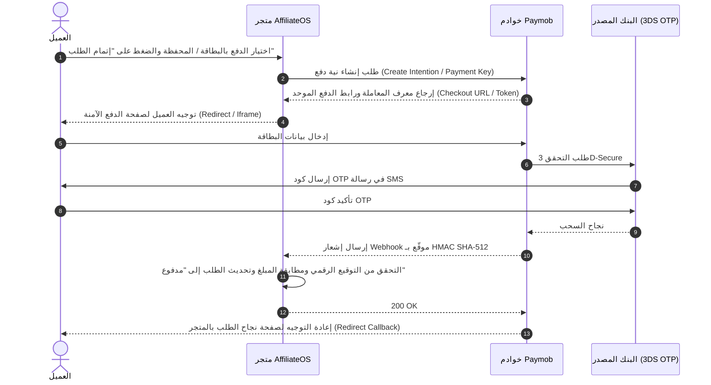

# 12 — بوابات الدفع الإلكتروني للتجارة في مصر (E-Commerce Payment Gateways in Egypt)

## 1. المشهد العام للمدفوعات الإلكترونية للتجارة في مصر

تتنوع خيارات الدفع المتاحة للمتاجر الإلكترونية في مصر بين وسائل تقليدية ورقمية متسارعة النمو:

1. **البطاقات البنكية (Bank Cards):**
   - بطاقات الائتمان والخصم المباشر (Visa و Mastercard).
   - بطاقة الدفع الوطنية **ميزة (Meeza)**: مدعومة بنكياً وحكومياً وتغطي ملايين المواطنين وأصحاب المرتبات والمعاشات.
   - التحقق الثنائي الإلزامي **3D-Secure 2.0 (OTP)** صادر عن البنك المصدِر لكل حركة دفع عبر الإنترنت.
2. **المحافظ الإلكترونية الذكية (Mobile Wallets):**
   - فودافون كاش (Vodafone Cash)، أورنج كاش (Orange Cash)، اتصالات كاش (Etisalat Cash)، ووي باي (WE Pay)، بالإضافة للمحافظ البنكية (مثل البنك الأهلي، بنك مصر، CIB).
   - تشكل شريحة ضخمة جداً في الشراء عبر الإنترنت في مصر نظراً لسهولة استخدامها وسرعة انتشارها دون الحاجة لحساب بنكي تقليدي.
3. **شبكات التحصيل النقدي ومنافذ البيع (Kiosk / Cash Collection):**
   - شبكة **فوري (Fawry)**، أمان (Aman)، ومصاري (Masary).
   - يحصل العميل على "رقم مرجعي" (Reference Number) ويدفع كاش في أقرب كشك أو متجر تجزئة خلال مهلة محددة (24-72 ساعة).
4. **تطبيقات الدفع اللحظي (Instapay / IPN):**
   - شبكة المدفوعات اللحظية المدارة من البنك المركزي المصري (CBE). حالياً تُستخدم كتحويلات مباشرة بين الأفراد والتجار، وتعمل البنوك على إتاحة واجهات برمجية مباشرة (APIs) للتجارة الإلكترونية مستقبلاً.

---

## 2. مقارنة شاملة بين أبرز بوابات الدفع للتجار في مصر

| المعيار | Paymob (Accept) | FawryPay | Kashier |
|---|---|---|---|
| **الترخيص والاعتماد** | معتمد ومرخص من البنك المركزي المصري (CBE) | شركة مساهمة عامة مرخصة من CBE | مرخصة وتعمل بشراكة مع بنوك مصرية |
| **وسائل الدفع المدعومة** | كروت (Visa, Mastercard, Meeza)، محافظ ذكية، فوري، ValU (تقسيط)، Sympl، سهولة | كود فوري للمنافذ، بطاقات، محافظ، ValU | بطاقات بنكية، محافظ إلكترونية، كود فوري |
| **واجهات التكامل (APIs)** | Unified Checkout API, Payment Intent API, Mobile SDKs | Charge API, Hosted Page, Plugins | Hosted Payment Page, Drop-in UI |
| **التوجيه (Redirect vs Iframe)** | يدعم كلا النمطين (Hosted Checkout / Iframe) | يدعم Hosted Page والـ Pop-up | Hosted Checkout Page |
| **آلية توثيق الـ Webhook** | **HMAC SHA-512** مشفر بسلسلة مرتبة هجائياً | **SHA-256 Signature** باستخدام Secret Key | **HMAC SHA-256** على معايير الطلب |
| **الاسترداد (Refund)** | استرداد كلي وجزئي عبر API فوري | استرداد عبر لوحة التحكم و API | استرداد كلي وجزئي عبر API |
| **الرسوم التقريبية** | 2.75% + 3 جنيه للبطاقات، 1.5% للمحافظ | 2.50% إلى 2.75% + 2 إلى 3 جنيه | 2.75% + 3 جنيه للبطاقات |
| **بيئة الاختبار (Sandbox)** | متوفرة فوراً مع بطاقات اختبار ومحاكيات Webhook | متاحة عبر طلب حساب تجريبي | متاحة فور التسجيل |

---

## 3. التكامل التقني المفصل مع بوابة Paymob (البوابة المعتمدة أساسياً)

### 3.1. مسار عملية الدفع (Payment Flow)


### 3.2. التحقق من توقيع الـ Webhook (HMAC SHA-512 Calculation)
تضمن Paymob سلامة البيانات وعدم تزوير إشعارات الدفع عبر حساب توقيع HMAC-SHA512.
يتم استخراج القيم التالية بالترتيب الأبجدي الدقيق للمفاتيح ودمجها كنص متصل بدون فواصل:

1. `obj.amount_cents`
2. `obj.created_at`
3. `obj.currency`
4. `obj.error_occured`
5. `obj.has_parent_transaction`
6. `obj.id`
7. `obj.integration_id`
8. `obj.is_3d_secure`
9. `obj.is_auth`
10. `obj.is_capture`
11. `obj.is_refunded`
12. `obj.is_standalone_payment`
13. `obj.is_voided`
14. `obj.order.id`
15. `obj.owner`
16. `obj.pending`
17. `obj.source_data.pan`
18. `obj.source_data.sub_type`
19. `obj.source_data.type`
20. `obj.success`

ثم يُحسب التوقيع:
```php
$calculatedSignature = hash_hmac('sha512', $concatenatedString, $tenantHmacSecret);
$isValid = hash_equals($calculatedSignature, $incomingHmac);
```

### 3.3. ضمان عدم التكرار (Idempotency)
- كل عملية دفع ناجحة تحمل `transaction_id` فريد من البوابة.
- يُسجل النظام المعاملة في جدول `payment_transactions` مع قيد فريد `UNIQUE(tenant_id, transaction_ref)`.
- في حال إعادة إرسال الـ Webhook من البوابة (Retry Policy)، يتحقق النظام من المعاملة السابقة ويعيد استجابة `200 OK` فوراً دون تكرار أي أحداث مالية أو تغييرات في حالة الطلب.

### 3.4. الاسترداد المالي (Refunds)
- يُنفذ الاسترداد عبر استدعاء نقطة النهاية: `POST https://accept.paymob.com/api/acceptance/void_refund/refund`
- يتم تمرير:
  - `auth_token`: رمز مصادقة التاجر.
  - `transaction_id`: معرف المعاملة الأصلية المراد ردها.
  - `amount_cents`: المبلغ المراد استرداده بالقروش (يدعم الاسترداد الجزئي أو الكلي).
- يتم تسجيل حركة سالبة في معاملات الدفع، وإطلاق حدث `PaymentRefunded`.

---

## 4. إعدادات البوابة لكل تاجر في النظام (Multi-Tenant Gateway Settings)

لكل تاجر حسابه المستقل الخاص به لدى Paymob (أو أي بوابة أخرى)؛ لذلك يتم حفظ إعدادات البوابة لكل مستأجر `tenant` على حدة:

1. **المفاتيح المطلوبة لحساب التاجر:**
   - `api_key`: المفتاح السري للواجهة البرمجية (Secret API Key).
   - `hmac_secret`: مفتاح التحقق من توقيع الـ Webhooks.
   - `integration_id_card`: معرف تكامل البطاقات البنكية (Online Card Integration ID).
   - `integration_id_wallet`: معرف تكامل المحافظ الذكية (Mobile Wallets Integration ID).
   - `iframe_id`: معرف إطار الدفع المخصص للتاجر.
2. **التشفير الإلزامي (Encryption):**
   - تُخزن هذه المفاتيح في قاعدة البيانات مشفرة باستخدام تشفير AES-256-GCM عبر خاصية `casts => ['credentials' => 'encrypted:array']` في Laravel.
   - لا يمكن لأي تاجر أو جهة خارجية الاطلاع على مفاتيح تاجر آخر.

---

## 5. بيانات الاختبار في بيئة الـ Sandbox (Test Credentials)

| وسيلة الدفع | رقم البطاقة / الحساب التجريبي | تاريخ الانتهاء | رمز الأمان (CVV) | كود التحقق 3DS OTP | النتيجة المتوقعة |
|---|---|---|---|---|---|
| **Visa (ناجحة)** | `4111 1111 1111 1111` | أي تاريخ مستقبلي (مثال: `12/28`) | `123` | `1234` | سداد ناجح ومصادق |
| **Mastercard (ناجحة)** | `5555 5555 5555 5555` | أي تاريخ مستقبلي (مثال: `10/27`) | `321` | `1234` | سداد ناجح ومصادق |
| **بطاقة مرفوضة** | `4000 0000 0000 0002` | أي تاريخ مستقبلي | `123` | N/A | رصيد غير كافٍ / عملية مرفوضة |
| **محفظة فودافون كاش** | `01012345678` | N/A | N/A | كود وهمي عبر الشاشة | سداد ناجح عبر محاكي المحفظة |

---

## 6. واجهة محفظة العميل الأولية (Customer Wallet Interface)

تتضمن هذه المرحلة الأساس المعماري لمحفظة العميل:
- جدول `customer_wallets` يحفظ رصيد العميل `balance_minor` والعملة.
- واجهة برمجية `CustomerWalletServiceInterface` تدعم عمليات:
  - `getBalance(Customer $customer): Money`
  - `credit(Customer $customer, Money $amount, string $reason)`
  - `debit(Customer $customer, Money $amount, string $reason)`
- القيود المزدوجة المحاسبية الكاملة ودفتر الأستاذ (Double-entry Ledger) سيتم ربطهما في مرحلة الفاينانس P19.
