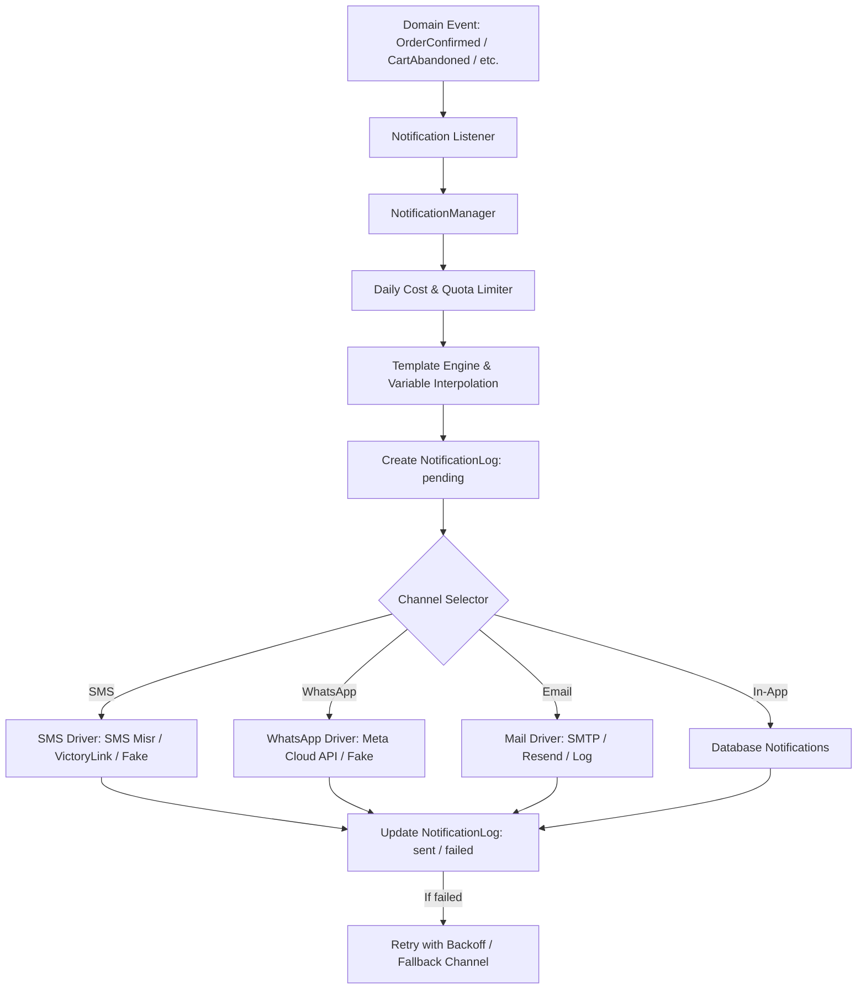

# 13 — توثيق مزودي الرسائل والإشعارات في مصر (SMS & WhatsApp & Push)

توثّق هذه الوثيقة خيارات الربط والتكامل لخدمات الرسائل النصية القصيرة (SMS)، وواتساب للأعمال (WhatsApp Business Platform)، والبريد الإلكتروني، والإشعارات الفورية (Push/In-App) في جمهورية مصر العربية، مع مراعاة القيود التنظيمية (الجهاز القومي لتنظيم الاتصالات NTRA)، وتكلفة الإرسال، ومسارات السقوط الآمن (Graceful Fallback).

---

## 1. قنوات الإشعارات وسيناريوهات الاستخدام في المتجر

| القناة | حالات الاستخدام الرئيسية | سرعة الوصول | التكلفة التقديرية (مصر) | الحساسية للفشل |
|---|---|---|---|---|
| **SMS** | رموز التحقق (OTP)، إشعار تأكيد الطلب، إشعار الشحن مع رقم التتبع | فورية (< 10 ثوانٍ) | 0.20 - 0.45 ج.م للرسالة | حرجة (يجب ألا توقف تدفق الطلب) |
| **WhatsApp** | إشعار السلة المتروكة برابط الاسترجاع، تحديث حالة الشحنة، رابط الفاتورة، تأكيد الطلب | شبه فورية | تسعير المحادثات Utility / Marketing | حرجة ولكن خلف Queue |
| **Email** | ترحيب المتجر، فاتورة الشراء التفصيلية، ملخصات النشرة البريدية | ثوانٍ إلى دقائق | منخفضة جداً (كسور القرش) | غير حرجة |
| **In-App** | إشعارات لوحة التاجر (طلب جديد، مخزون منخفض)، إشعارات حساب العميل | فورية | صفرية (قاعدة بيانات / WebSockets) | غير حرجة |
| **Web Push** | تنبيهات العروض اللحظية، عودة المنتج المتوفر | فورية (بموافقة المتصفح) | صفرية (بروتوكول VAPID) | اختيارية |

---

## 2. مزودو الرسائل القصيرة (SMS) في مصر

### 2.1 الإطار التنظيمي (NTRA)
- يفرض الجهاز القومي لتنظيم الاتصالات (NTRA) ترخيص أسماء المرسلين (Sender ID).
- يتطلب تسجيل اسم مرسل تجاري (Sender ID) مثل `AffiliateOS` أو اسم المتجر: سجل تجاري، بطاقة ضريبية، وتفويض رسمي لشركة الـ SMS. يستغرق الاعتماد بين 3 إلى 7 أيام عمل.
- الرسائل الترويجية (Marketing) لها أوقات محددة للإرسال (من 9 صباحاً حتى 9 مساءً بتوقيت القاهرة)، بينما رسائل المعاملات والـ OTP (Transactional) تعمل 24/7 دون قيود زمنية.

### 2.2 مقارنة المزودين المحليين

#### 1. SMS Misr (إس إم إس مصر)
- **الموقع:** `https://smsmisr.com`
- **المميزات:**
  - توثيق API بسيط وسهل التكامل عبر REST JSON أو Query Params.
  - توجيه مباشر للشبكات الأربع (فودافون، أورنج، إي آند اتصالات، وي).
  - دعم قنوات OTP مخصصة (Priority Routes) مع زمن وصول < 5 ثوانٍ.
  - أسعار تنافسية تبدأ من 0.22 - 0.35 ج.م للحزمة.
  - إرجاع أرصدة الفشل التلقائي ودعم تقارير التسليم DLR عبر Webhooks.
- **التكامل:** HTTP POST مع `username`, `password`, `sender`, `mobile`, `message`.

#### 2. VictoryLink (فيكتوري لينك)
- **الموقع:** `https://victorylink.com`
- **المميزات:**
  - المزود الأقدم والأكبر في السوق المصري والمرخص رسمياً كـ Tier-1 Aggregator.
  - دعم الرسائل ثنائية الاتجاه (2-way SMS) وأرقام الـ Shortcodes.
  - مناسب للحسابات الكبيرة التي تحتاج عقود فواتير ضريبية محلية مباشرة.
  - بوابة API تدعم XML/JSON مع معايير أمان عالية.

#### 3. CEQUENS (سيكوينز)
- **الموقع:** `https://cequens.com`
- **المميزات:**
  - منصة CPaaS إقليمية رائدة تدعم الـ SMS والـ WhatsApp Business في نفس الواجهة.
  - لوحة تحكم عصرية متطورة وتقارير لحظية دقيقة جداً.
  - توجيه ذكي وبوابات fallback دولية ومحلية.

---

## 3. منصة واتساب للأعمال (WhatsApp Business Platform)

### 3.1 هيكل التسعير (Meta Conversation-Based Pricing)
تعتمد Meta نموذج المحادثات لمدة 24 ساعة مقسمة إلى:
1. **Utility (المعاملات والتنبيهات):** رسائل تأكيد الطلب، الشحن، تحديثات الحساب (أقل تكلفة).
2. **Marketing (التسويق):** عروض الفلاش، السلات المتروكة، كوبونات الخصم.
3. **Authentication (التحقق):** رموز الـ OTP.
4. **Service (خدمة العملاء):** الرد على استفسارات العملاء المفتوحة من جهتهم (أول 1000 محادثة شهرياً مجاناً).

### 3.2 خيارات الربط الفني:
1. **Direct Meta Cloud API (مُوصى به للنظام المتعدد التجار):**
   - استدعاء مباشر لـ `graph.facebook.com/v19.0/{phone_number_id}/messages`.
   - التاجر يدخل `phone_number_id`, `waba_id`, `access_token` الخاص بحسابه، أو استخدام حساب منصة AffiliateOS الموحد مع احتساب التكلفة.
   - يدعم إرسال القوالب التفاعلية (Interactive Templates) مثل أزرار الرد السريع وروابط الاسترجاع.
2. **Local BSP (مثل Cequens أو Unifonic):** خيار بديل في حال الدفع بالجنيه المصري للمؤسسات.

---

## 4. بنية محرك الإشعارات في AffiliateOS

### 4.1 القواعد الصارمة لمحرك الإشعارات:
1. **عدم إيقاف المعاملات (Non-blocking):** فشل أي مزود إشعار لا يجوز إطلاقاً أن يوقف إتمام الطلب أو تسجيل العميل أو معالجة الدفع. تُشغّل وظائف الإرسال دائمًا عبر طوابير غير متزامنة (`ShouldQueue`).
2. **سجل تدقيق كامل (Append-only Notification Log):** تسجيل كل محاولة إرسال، المعرف، القناة، المستقبل، القالب، التكلفة، والحالة (`pending, sent, delivered, failed`).
3. **محرك قوالب آمن (Safe Variable Interpolation):** دعم استبدال المتغيرات الآمنة بصيغة `{customer_name}`, `{order_number}`, `{order_total}`, `{store_name}`, `{tracking_url}`, `{recovery_url}` مع منع تشغيل أي تعليمات برمجية خبيثة.
4. **عزل المستأجرين (Tenant Isolation):** يمكن لكل تاجر تكوين مزوداته ومفاتيحه الخاصة مشفرة (`encrypted`)، أو استخدام مزود المنصة الافتراضي مع فرض سقف يومي (`daily_spend_limit`).
