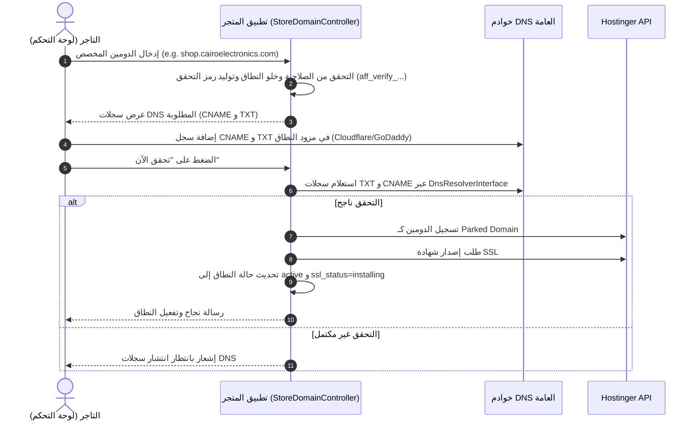

# 17 — ربط الدومينات المخصصة وإدارة شهادات SSL والتوجيه (ADR-012)

## 1. السياق والحاجة (Context)

يحتاج تجار التجزئة والمسوقون على منصة AffiliateOS إلى تشغيل متاجرهم بهويتهم التجارية الخاصة وعبر نطاقاتهم المخصصة (مثل `cairo-store.com` أو `shop.mybrand.com`) بدلاً من الاكتفاء بالنطاق الفرعي الافتراضي (`store-slug.affiliate-os.com`).

متطلبات هذا القرار تشمل:
1. **التحقق من الملكية:** منع أي مستأجر من إضافة دومين لا يملكه، عبر سجلات DNS (TXT Challenge و CNAME).
2. **عزل المستأجرين والتوجيه:** توجيه زوار الدومين المخصص مباشرة إلى متجر التاجر الصحيح عبر Stancl Tenancy.
3. **شهادات الأمان (SSL/TLS):** إصدار شهادة HTTPS مشفرة وصالحة لكل دومين مخصص تلقائياً.
4. **العمل على الاستضافة المشتركة (Hostinger Business):** التوافق مع قيود الاستضافة المشتركة الحالية ثم إمكانية الترقية لـ VPS دون تغيير الكود.
5. **الوضع الأبيض (White-Label):** إخفاء اسم وشعار المنصة في باقة المؤسسات العليا.

---

## 2. القرارات المعمارية المعتمدة (Decisions)

### 2.1 إدارة الدومين على استضافة Hostinger المشتركة (الحالية)
- يتم تسجيل الدومين المخصص كـ **Parked/Alias Domain** مرتبط بالنطاق الرئيسي للمنصة (`affiliate-os.com`) باستخدام Hostinger API:
  - `POST /hosting/websites/{domain}/parked` (`hosting_domains_create-website-parked`)
- يتم طلب وتفعيل شهادة SSL المجانية المدارة عبر Hostinger API:
  - `POST /hosting/websites/{domain}/ssl` (`hosting_ssl_install`)
  - الاستعلام الدوري عن حالة الشهادة عبر `GET /hosting/websites/{domain}/ssl` (`hosting_ssl_status`)
- **حدود الخطة:** خطة Hostinger Business تدعم حتى 100 موقع/دومين alias. يتم احتساب عدد الدومينات النشطة ومراقبتها.

### 2.2 الترقية المستقبلية إلى VPS (Caddy On-Demand TLS)
- عند تجاوز 50-70 دوميناً مخصصاً نشطاً أو الانتقال لخادم سحابي (VPS):
  - يتم استخدام **Caddy Web Server** كـ Reverse Proxy أمام Laravel Octane / PHP-FPM.
  - تفعيل ميزة **On-Demand TLS** في `Caddyfile`:
    ```caddy
    {
        on_demand_tls {
            ask http://127.0.0.1:8000/api/internal/domains/check
            interval 2m
            burst 5
        }
    }
    :443 {
        tls {
            on_demand
        }
        reverse_proxy 127.0.0.1:8000
    }
    ```
  - يتحقق Caddy من وجود النطاق في جدول `domains` وحالته `active` عبر الـ endpoint الداخلي قبل إصدار الشهادة فوراً عبر Let's Encrypt أو ZeroSSL.

---

## 3. مسار التحقق من النطاق (Verification Workflow)



---

## 4. سيناريو اختبار SSL والنطاق على Staging

1. **التهيئة (Setup):**
   - إضافة دومين تجريبي محلي أو بيئة Staging: `test-shop.affiliate-os.test` أو دومين مسجل تجريبي.
2. **التحقق من DNS:**
   - ضبط سجل `_affiliate-os-challenge.<domain>` بقيمة الرمز `verification_token`.
   - استدعاء `POST /store/domains/{id}/verify`.
   - التأكد من انتقال الحالة إلى `active` مع تسجيل وقت التحقق `verified_at`.
3. **التعيين كأساسي وإعادة التوجيه (301 Redirect):**
   - تعيين الدومين المخصص كنطاق أساسي `is_primary = true`.
   - تفعيل إعادة توجيه النطاق الفرعي `toggleRedirect = true`.
   - فتح النطاق الفرعي القديم للمتجر (`cairo-electronics.affiliate-os.com/products/123`).
   - التحقق من استقبال رد `301 Moved Permanently` وتوجيه المتصفح إلى `https://shop.cairoelectronics.com/products/123`.
4. **تحديد المستأجر (Tenancy Resolution):**
   - فتح الدومين المخصص عبر المتصفح: التأكد من تحميل الكتالوج وسلة المشتريات الخاصة بالمستأجر ذاته دون أي اختلاط مع مستأجرين آخرين.

---

## 5. ميزة الوضع الأبيض (White-Label)

- **التحكم بالصلاحيات:** مفعلة فقط في باقة المؤسسات `Enterprise` عبر `Features::enabled('white_label')`.
- **السلوك:**
  - عند التفعيل، يتم إخفاء جملة `"مشغل بواسطة منصة التجارة والتسويق بالعمولة AffiliateOS"` ورابط المنصة من تذييل المتجر وواجهات الشراء والفواتير.
  - المتاجر في باقات Starter و Pro تعرض الشارة الترويجية القياسية.
